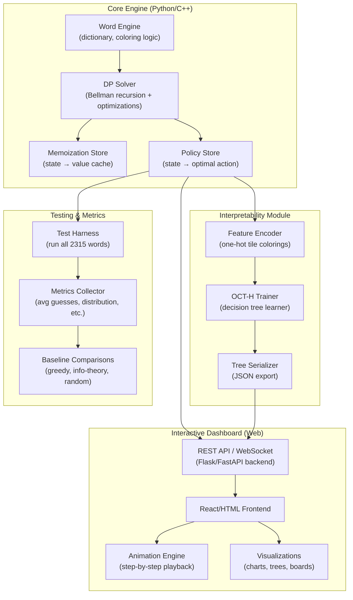
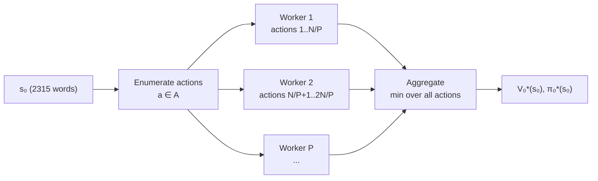
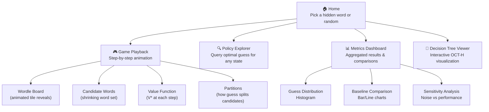

# High-Level Design Document

## An Exact and Interpretable Solution to Wordle — Implementation

**Paper:** *"An Exact and Interpretable Solution to Wordle"* — Dimitris Bertsimas & Alex Paskov (MIT)

**Date:** 2026-11-11  
**Version:** 1.0 — Initial Draft

---

## Table of Contents

1. [Project Overview](#1-project-overview)
2. [Paper Summary](#2-paper-summary)
3. [System Architecture](#3-system-architecture)
4. [Module Design](#4-module-design)
5. [Data Structures & State Representation](#5-data-structures--state-representation)
6. [Algorithm Design](#6-algorithm-design)
7. [Optimization Strategies](#7-optimization-strategies)
8. [Metrics & Testing Framework](#8-metrics--testing-framework)
9. [Interactive Dashboard](#9-interactive-dashboard)
10. [Technology Stack](#10-technology-stack)
11. [Directory Structure](#11-directory-structure)
12. [Development Roadmap](#12-development-roadmap)
13. [Risks & Mitigations](#13-risks--mitigations)

---

## 1. Project Overview

### 1.1 Goal

Implement the **Exact Dynamic Programming (EDP)** framework described in Bertsimas & Paskov's paper to produce a **certifiably optimal** policy for the game of Wordle. Complement the solver with:

- A **rigorous testing & metrics** suite that validates correctness and reproduces the paper's results.
- An **interactive dashboard** that animates every step of the solving process, making the DP policy tangible and interpretable.

### 1.2 Success Criteria

| Criterion | Target |
|---|---|
| Best starting word discovered | **SALET** |
| Average guesses (optimal, over all 2315 words) | **3.421** |
| Maximum guesses for any hidden word | **≤ 5** |
| Win rate (all 2315 words) | **100 %** |
| Dashboard shows step-by-step animation | Fully functional |
| OCT-H decision tree visualization | Renders for guess 2+ |

---

## 2. Paper Summary

### 2.1 Core Idea

The game of Wordle is modeled as a **finite-state Markov Decision Process (MDP)**:

| MDP Element | Definition |
|---|---|
| **State** $s_t$ | The set of remaining valid solution words at time step $t$ (initially all 2,315 words) |
| **Action** $a$ | Any word from the full guess vocabulary $A$ (10,657 words) |
| **Cost** $c_t(s, a)$ | 1 per guess; $\infty$ if the game is lost at $t = 6$ |
| **Transition** $P(s_t, a)$ | Partition of $s_t$ into next-states based on tile colorings produced by guess $a$ |

The **Bellman Equation** is:

$$V_t^*(s_t) = \min_{a \in A}\left[1 + \sum_{s_{t+1} \in P(s_t, a)} p_t(s_{t+1}; s_t, a) \cdot V_{t+1}^*(s_{t+1})\right]$$

### 2.2 Key Optimizations (from the paper)

1. **Terminal pruning:** At $t = 5$, if $|s_5| > 1 \Rightarrow V_5^* = \infty$; if $|s_5| = 1 \Rightarrow V_5^* = 1$.
2. **Two-word shortcut:** If $|s_t| = 2$ and $t < 6$, then $V_t^* = 1.5$.
3. **Pre-computed compatibility table:** A boolean table of size $|A| \times 3^5 \times 2315$ enables O(|s_t|) transition computation.
4. **Lower-bound pruning:** Use $LB(s_t) = \frac{2|s_t| - 1}{|s_t|}$ as a lower bound on $V_t^*$. Prune actions whose partial sum already exceeds the current best.
5. **Solutions-first heuristic:** Evaluate actions $a \in s_t$ before $a \in A \setminus s_t$, since the optimal guess is frequently a valid solution.

### 2.3 Interpretability via OCT-H

After computing the optimal policy, **Optimal Classification Trees with Hyperplanes (OCT-H)** are trained to represent the policy as a compact, human-readable decision tree. Feature representation uses a **one-hot encoding** of tile colorings (15 binary features per guess: 3 colors × 5 positions).

---

## 3. System Architecture



---

## 4. Module Design

### 4.1 Word Engine (`engine/words.py`)

Responsible for all word-level logic:

- **Dictionary loading** — Load the 2,315 solution words and 10,657 guess words from official Wordle word lists.
- **Tile coloring** — Given a guess and a hidden word, produce the 5-tile coloring (Green / Yellow / Gray), correctly handling repeated characters.
- **State filtering** — Given a state (set of candidate words) and a (guess, coloring) pair, compute the next state by filtering out incompatible words.
- **Compatibility pre-computation** — Build the $|A| \times 3^5 \times 2315$ boolean lookup table (Optimization 3).

### 4.2 DP Solver (`engine/solver.py`)

The core algorithm implementing the Bellman recursion:

- **Recursive value computation** — `compute_V(state, t)` implementing Algorithm 2 from the paper.
- **Memoization** — Dictionary mapping `(frozenset(state), t)` → float value. Explore time-independence (the paper notes but does not use this).
- **Action enumeration** — Solutions-first ordering (Optimization 5).
- **Pruning** — Lower-bound pruning (Optimization 4) with early termination.
- **Parallelization** — Multiprocessing at the first level: enumerate next-states from $s_0$ for each $a \in A$ and distribute across workers.

### 4.3 Policy Extractor (`engine/policy.py`)

After the DP solver has computed values:

- **Argmin extraction** — For each visited state, record the action achieving the minimum in the Bellman equation.
- **Policy serialization** — Export the full policy as a lookup table (JSON/pickle) for fast dashboard queries.
- **Game simulator** — Given a hidden word, play out the optimal policy step-by-step, recording every intermediate state, guess, coloring, and remaining candidates.

### 4.4 Interpretability Module (`interpretability/`)

- **Feature encoder** — Convert a game history (sequence of guesses + colorings) into the 15n-dimensional binary feature vector described in Section 2.4 of the paper.
- **OCT-H trainer** — Train Optimal Classification Trees with Hyperplanes on (features → optimal next guess) data. Use scikit-learn `DecisionTreeClassifier` as a baseline; optionally integrate with [Interpretable AI](https://www.interpretable.ai/) for true OCT-H.
- **Tree export** — Serialize the trained tree to JSON for dashboard visualization, including node questions (which tile positions/colors to check) and leaf actions (which word to guess).

### 4.5 Testing & Metrics (`tests/`)

See [Section 8](#8-metrics--testing-framework) for full details.

### 4.6 Dashboard (`dashboard/`)

See [Section 9](#9-interactive-dashboard) for full details.

---

## 5. Data Structures & State Representation

### 5.1 Core Data Types

```
State       := frozenset[int]       # Set of word indices (into the 2315 solutions list)
Action      := int                  # Index into the 10657 guesses list
Coloring    := int                  # 0–242 (base-3 encoding of 5 tiles: G=2, Y=1, X=0)
TimeStep    := int                  # 0–5 (guess number)
Value       := float                # Expected guesses remaining from this state
```

### 5.2 Pre-computed Tables

| Table | Shape | Description |
|---|---|---|
| `coloring_table` | `(10657, 2315)` → `uint8` | The coloring produced when guess `a` is played against hidden word `w` |
| `compatibility` | `(10657, 243, 2315)` → `bool` | Whether solution `w` is compatible with guess `a` receiving coloring `c` |
| `partition_cache` | `dict` | Cached partitions of states by coloring |

### 5.3 Memoization

```python
V_memory: dict[tuple[frozenset[int], int], float]  # (state, timestep) → optimal value
π_memory: dict[tuple[frozenset[int], int], int]     # (state, timestep) → optimal action index
```

> [!NOTE]
> The state is represented as a `frozenset` of integer word-indices rather than strings for memory efficiency and fast hashing. A state with $|s| = k$ words is uniquely identified by its frozenset.

---

## 6. Algorithm Design

### 6.1 Algorithm 1 — Get Transition Information

```
function get_transitions(state, action):
    partitions = {}
    for each word w in state:
        coloring = compute_coloring(action, w)
        next_state = {w' ∈ state : compatible(action, coloring, w')}
        partitions[frozenset(next_state)] += 1/|state|
    return partitions
```

### 6.2 Algorithm 2 — Compute V*(s_t)

```
function compute_V(state, t, V_memory):
    // Optimization 1: Terminal states
    if t == 6 or (t == 5 and |state| > 1): return ∞
    if t == 5: return 1

    // Base cases
    if |state| == 1: return 1
    if |state| == 2: return 1.5   // Optimization 2

    // Memoization lookup
    if (state, t) in V_memory: return V_memory[(state, t)]

    best_value = ∞

    // Optimization 5: solutions-first ordering
    for action in (state ∪ (A \ state)):
        partial_sum = 1
        next_states = get_transitions(state, action)

        // Optimization 3: skip non-informative actions
        if |next_states| == 1 and state ∈ next_states: continue

        // Optimization 4: lower-bound initialization
        for s' in next_states:
            partial_sum += (2|s'| - 1) / |s'|   // lower bound on V*(s')

        // Exact evaluation with pruning
        for s' in next_states (sorted by largest partition first):
            if partial_sum >= best_value: break   // prune
            if s' == {action}: continue           // already counted as 1
            partial_sum += V*(s', t+1) - LB(s')   // replace LB with exact

        best_value = min(best_value, partial_sum)

    V_memory[(state, t)] = best_value
    return best_value
```

### 6.3 Parallelization Strategy



At the first level, each worker independently evaluates a subset of actions and recursively computes values for reachable sub-states. Workers share a thread-safe memoization cache.

---

## 7. Optimization Strategies

### 7.1 Computational Optimizations

| # | Optimization | Expected Impact |
|---|---|---|
| O1 | Terminal pruning ($t=5$) | Reduces effective horizon from 6 to 5 |
| O2 | $|s|=2$ shortcut ($V=1.5$) | Avoids recursion for ~30% of leaf states |
| O3 | Pre-computed compatibility table | O(|s|) transitions instead of O(|s|²) |
| O4 | Lower-bound pruning | Prunes ~90%+ of actions per state |
| O5 | Solutions-first action ordering | Finds good upper bounds early, improving pruning |

### 7.2 Implementation-Level Optimizations

| Optimization | Description |
|---|---|
| **NumPy vectorization** | Coloring computation and filtering via vectorized array ops |
| **Bitset state representation** | Represent states as bitmasks for O(1) set operations |
| **C++ hot path** | Implement the innermost recursion loop in C++ with Python bindings (pybind11) |
| **LRU + disk caching** | Spill large memo tables to disk (shelve/sqlite) if memory is constrained |
| **Symmetry breaking** | Group equivalent states (same word set, different order) — already handled by frozenset |

---

## 8. Metrics & Testing Framework

### 8.1 Correctness Tests

| Test | Description | Expected |
|---|---|---|
| `test_coloring_basic` | Verify tile coloring for known guess/answer pairs | Match game rules |
| `test_coloring_repeats` | Verify coloring with repeated characters | Match paper's rules |
| `test_state_transition` | Verify state filtering produces correct next-states | Exact match |
| `test_bellman_small` | Solve a toy game (e.g., 10 words, 3 guesses) and verify by brute force | Match brute force |
| `test_two_word_shortcut` | Verify $V^* = 1.5$ for all 2-word states | 1.5 |
| `test_terminal_states` | $V^*(s_5) = 1$ if $|s|=1$, $\infty$ otherwise | Correct |

### 8.2 Paper-Reproduction Metrics

| Metric | Paper Value | How Measured |
|---|---|---|
| Best starting word | SALET | `argmin_{a} V_0^*(s_0)` with first guess $a$ |
| Expected guesses (SALET start) | 3.421 | Average over all 2,315 games |
| Max guesses (any word) | ≤ 5 | Max over all 2,315 games |
| Win rate | 100% | All 2,315 games won |
| Guess distribution | 2→4.0%, 3→57.1%, 4→35.6%, 5→3.3% | Histogram over all games |
| Top 5 starting words | SALET, REAST, TRACE, CRATE, SLATE | Top-5 by expected guesses |

### 8.3 Comparative Baselines

| Baseline | Description |
|---|---|
| **Random** | Pick a random valid guess each turn |
| **Greedy (max-info)** | Pick the guess that maximizes expected information gain (entropy) |
| **Greedy (max-partitions)** | Pick the guess that produces the most distinct next-states |
| **2-Step Greedy** | Look ahead 2 steps greedily (approximation of paper's approach) |
| **RL-based** | Simple Q-learning or policy gradient agent (to reproduce paper's Section 3.5) |

### 8.4 Sensitivity Analysis (Reproducing Section 3.5)

- Perturb $V_3^*(s_3)$ by $x\%$ (for $x \in \{0.1, 0.5, 1, 2, 5, 10\}$).
- Re-derive the policy from perturbed values.
- Measure expected guesses and win rate of the perturbed policy.
- Run 25 simulations per perturbation level.

### 8.5 Performance Benchmarks

| Metric | Measurement |
|---|---|
| Total solve time (full DP) | Wall-clock hours on target hardware |
| Memory usage (peak) | GB of RAM |
| States memoized | Count of unique (state, t) entries |
| Actions pruned (%) | Fraction of actions pruned by Opt. 4 |

---

## 9. Interactive Dashboard

### 9.1 Overview

A web-based dashboard that **animates the step-by-step process** of solving any Wordle puzzle using the optimal DP policy. The user picks a hidden word (or one is chosen randomly), and the dashboard walks through each guess with full visualization.

### 9.2 Dashboard Pages / Views



### 9.3 Animation Steps (Game Playback View)

For a selected hidden word, the dashboard animates through each guess:

| Step | What is shown |
|---|---|
| **1. State display** | Current set of candidate words $s_t$ (count + scrollable list) |
| **2. Action selection** | Highlight the optimal guess $a^*$ — show why it's chosen (value, alternatives considered) |
| **3. Tile reveal** | Animate the Wordle board: tiles flip one-by-one revealing Green/Yellow/Gray |
| **4. Partition visualization** | Show how the guess partitions $s_t$ into next-states (treemap or bar chart of partition sizes) |
| **5. State reduction** | Animate the candidate list shrinking — fade out eliminated words, highlight remaining |
| **6. Value update** | Display $V_t^*(s_t) \to V_{t+1}^*(s_{t+1})$ — the value function stepping forward |
| **7. Repeat or victory** | Loop to step 1 with $t+1$, or show victory animation with final stats |

### 9.4 Key UI Components

1. **Wordle Board** — Classic 6×5 grid with animated tile-flip reveals and color transitions.
2. **Candidate Word Cloud** — Visual showing remaining candidate words, sized by frequency or grouped by letter patterns. Animates shrinkage.
3. **Partition Treemap** — After each guess, shows how the candidate set splits. Each block represents a next-state, sized proportionally.
4. **Value Function Timeline** — Line chart showing $V^*$ at each step, with the optimal path highlighted.
5. **Decision Tree Navigator** — Interactive OCT-H tree for the current guess level. Highlights the path taken for the current game state.
6. **Playback Controls** — Play/Pause, Step Forward/Back, Speed slider, Auto-play toggle.
7. **Metrics Sidebar** — Running stats for the current game (guesses used, candidates remaining, information gained per guess).

### 9.5 Dashboard Tech

| Component | Technology |
|---|---|
| Frontend | React + TypeScript + Tailwind CSS |
| Animations | Framer Motion / CSS animations |
| Charts | D3.js or Recharts |
| Tree visualization | Custom D3 tree layout or react-d3-tree |
| Backend API | FastAPI (Python) |
| Data transport | REST + WebSocket (for animation streaming) |

---

## 10. Technology Stack

| Layer | Choice | Rationale |
|---|---|---|
| **Core Solver** | Python 3.11+ with NumPy | Rapid prototyping, vectorized ops |
| **Hot Path** | C++ with pybind11 (optional) | 10–100x speedup for innermost recursion |
| **Parallelization** | `multiprocessing` / `concurrent.futures` | Trivially parallelizable per the paper |
| **Decision Trees** | scikit-learn (baseline) + InterpretableAI (OCT-H) | Paper uses OCT-H; sklearn is fallback |
| **Backend API** | FastAPI | Async, fast, auto-docs |
| **Frontend** | React + TypeScript | Rich interactivity, component ecosystem |
| **Visualization** | D3.js, Recharts, Framer Motion | Publication-quality charts + animations |
| **Testing** | pytest + hypothesis | Property-based testing for correctness |
| **CI/CD** | GitHub Actions | Automated tests on push |
| **Documentation** | Markdown in `docs/` | Versioned with code |

---

## 11. Directory Structure

```
AI wordle Project/
├── docs/
│   ├── HIGH_LEVEL_DESIGN.md          # ← This document
│   ├── IMPLEMENTATION_NOTES.md       # Detailed implementation decisions
│   └── METRICS_REPORT.md             # Testing results & analysis
│
├── engine/                           # Core solver
│   ├── __init__.py
│   ├── words.py                      # Dictionary & coloring logic
│   ├── solver.py                     # DP Bellman recursion
│   ├── policy.py                     # Policy extraction & game simulator
│   ├── precompute.py                 # Compatibility table builder
│   └── utils.py                      # Shared utilities
│
├── interpretability/                 # OCT-H & feature encoding
│   ├── __init__.py
│   ├── features.py                   # One-hot tile coloring encoder
│   ├── tree_trainer.py               # Decision tree training
│   └── tree_export.py                # JSON serialization
│
├── baselines/                        # Comparison strategies
│   ├── __init__.py
│   ├── random_solver.py
│   ├── greedy_entropy.py
│   ├── greedy_partitions.py
│   └── two_step_greedy.py
│
├── tests/                            # Test suite
│   ├── test_coloring.py
│   ├── test_transitions.py
│   ├── test_solver.py
│   ├── test_policy.py
│   ├── test_metrics.py
│   └── test_baselines.py
│
├── dashboard/                        # Interactive web dashboard
│   ├── backend/
│   │   ├── app.py                    # FastAPI server
│   │   ├── routes/
│   │   └── services/
│   └── frontend/
│       ├── src/
│       │   ├── components/
│       │   │   ├── WordleBoard.tsx
│       │   │   ├── CandidateCloud.tsx
│       │   │   ├── PartitionTreemap.tsx
│       │   │   ├── ValueTimeline.tsx
│       │   │   ├── DecisionTreeViewer.tsx
│       │   │   └── PlaybackControls.tsx
│       │   ├── pages/
│       │   │   ├── Home.tsx
│       │   │   ├── GamePlayback.tsx
│       │   │   ├── PolicyExplorer.tsx
│       │   │   ├── MetricsDashboard.tsx
│       │   │   └── TreeViewer.tsx
│       │   └── App.tsx
│       ├── package.json
│       └── tsconfig.json
│
├── data/
│   ├── solutions.txt                 # 2,315 solution words
│   ├── guesses.txt                   # 10,657 valid guesses
│   └── precomputed/                  # Cached tables & policies
│
├── scripts/
│   ├── run_solver.py                 # CLI to run the full DP solve
│   ├── run_metrics.py                # Generate metrics report
│   └── run_sensitivity.py            # Sensitivity analysis (Section 3.5)
│
├── Wordle_Paper_Final.pdf            # Source paper
├── .gitignore
├── README.md
├── requirements.txt
└── pyproject.toml
```

---

## 12. Development Roadmap


### Phase 1 — Core Engine (Weeks 1–2)

- [ ] Load word lists (solutions + guesses)
- [ ] Implement tile coloring with repeated-character handling
- [ ] Build pre-computed compatibility table
- [ ] Implement Bellman recursion with all 5 optimizations
- [ ] Add memoization & policy extraction
- [ ] Add multiprocessing parallelization
- [ ] Verify on small word subsets (10, 50, 100 words)

### Phase 2 — Metrics & Testing (Week 3)

- [ ] Unit tests for coloring, transitions, terminal cases
- [ ] Full 2,315-word evaluation harness
- [ ] Reproduce paper's key metrics (avg 3.421, max 5, SALET)
- [ ] Implement baseline solvers (random, greedy, 2-step)
- [ ] Comparative metrics & charts
- [ ] Sensitivity analysis (Section 3.5 reproduction)

### Phase 3 — Interpretability (Week 4)

- [ ] Feature encoder (one-hot tile colorings)
- [ ] Train decision trees (sklearn baseline)
- [ ] Export trees to JSON
- [ ] Validate tree predictions against policy lookup

### Phase 4 — Dashboard (Weeks 5–6)

- [ ] FastAPI backend: game simulation endpoint, policy query endpoint
- [ ] React frontend: Wordle board with tile-flip animations
- [ ] Candidate word visualization (shrinking set)
- [ ] Partition treemap after each guess
- [ ] Value function timeline
- [ ] Decision tree interactive viewer
- [ ] Playback controls (play/pause/step/speed)
- [ ] Metrics dashboard page (histograms, comparisons)

### Phase 5 — Polish & Documentation (Week 7)

- [ ] Performance optimization (C++ hot path if needed)
- [ ] End-to-end integration tests
- [ ] Write README, implementation notes
- [ ] Generate final metrics report
- [ ] CI/CD setup with GitHub Actions

---

## 13. Risks & Mitigations

| Risk | Impact | Likelihood | Mitigation |
|---|---|---|---|
| **Full DP solve too slow in Python** | High | Medium | Phase 1: validate on subsets first; Phase 5: C++ hot path via pybind11. Use aggressive pruning. |
| **Memory exhaustion** from memoization | High | Medium | Use integer indices, frozenset compression, disk-backed memo (shelve/sqlite). |
| **OCT-H requires commercial library** | Medium | High | Use sklearn `DecisionTreeClassifier` as baseline; only use InterpretableAI if available. |
| **Word list discrepancy** vs. paper | Medium | Low | Source official NYT Wordle word lists; document any differences. |
| **Dashboard animation performance** | Low | Medium | Virtualize large word lists; limit animation frame rate; lazy-load data. |
| **Numerical precision** in value function | Medium | Low | Use `float64` throughout; validate against known $V^*(s) = 1.5$ for $|s|=2$ cases. |

---

> [!IMPORTANT]
> This is the **initial high-level design**. Detailed implementation decisions (e.g., exact C++ interface, OCT-H hyperparameters, dashboard component specs) will be documented in `docs/IMPLEMENTATION_NOTES.md` as development progresses.

